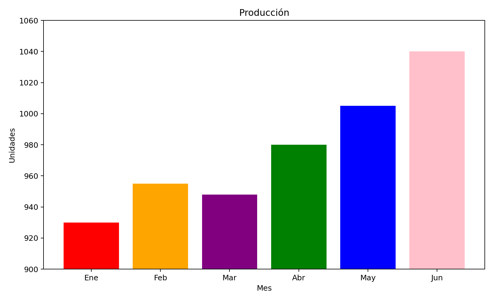
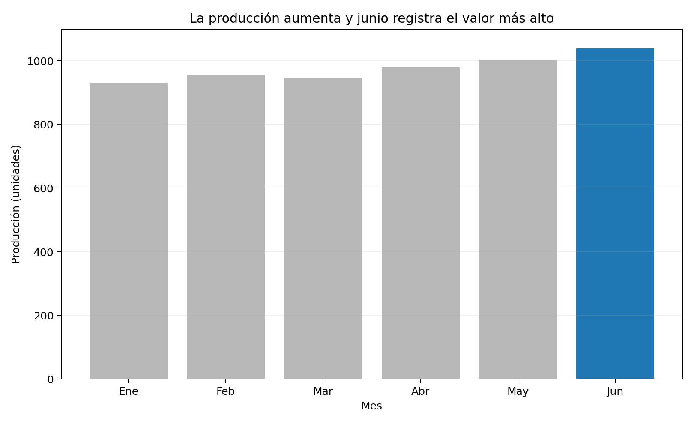

# Actividad Semana 12 - Rediseño de un gráfico

En esta actividad se tomó un gráfico de barras de producción mensual y se rediseñó aplicando principios básicos de visualización.

## Diagnóstico del gráfico original

El gráfico original usa un eje Y truncado que comienza en 900, por lo que las diferencias entre los meses parecen mucho más grandes de lo que realmente son. Además, utiliza varios colores sin un propósito específico y el título solamente dice “Producción”, sin comunicar una conclusión.

## Antes

## Después

## Justificación

En el rediseño hice que el eje vertical comenzara en cero para mostrar las diferencias de forma más honesta. Cambié el título por uno que comunica directamente la conclusión principal del gráfico. También eliminé los colores innecesarios y dejé un solo color destacado para señalar el mes con mayor producción. Con estos cambios el gráfico queda más claro, fácil de leer y menos propenso a interpretaciones exageradas.

## Archivos

- `actividad_semana12.py`: código utilizado para crear los dos gráficos.
- `actividad_semana12.ipynb`: cuaderno Jupyter con el desarrollo.
- `datos_produccion.csv`: datos usados en la actividad.
- `01_antes_grafico_mal_diseniado.png`: gráfico original.
- `02_despues_grafico_redisenado.png`: gráfico mejorado.
- `Informe_Actividad_Semana12.pdf`: informe final.
- `requirements.txt`: librerías utilizadas.

## Bibliografía

- Cairo, A. (2016). *The Truthful Art: Data, Charts, and Maps for Communication*. New Riders.
- Matplotlib development team. (2026). *Matplotlib documentation*. https://matplotlib.org/stable/
