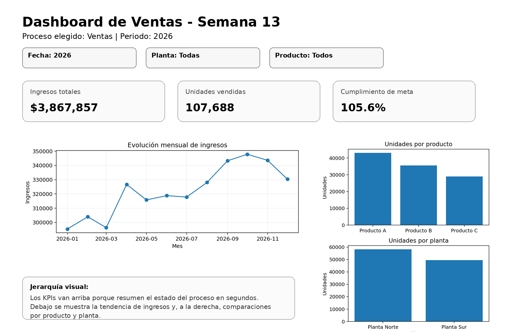

# Actividad Semana 13 - Diseño de un dashboard

Para esta actividad elegí el proceso de **ventas** y definí tres indicadores que permiten revisar rápidamente el desempeño del proceso.

## KPIs

1. **Ingresos totales**
   - Valor actual: $3,867,857
   - Objetivo: medir cuánto dinero generan las ventas durante el periodo seleccionado.

2. **Unidades vendidas**
   - Valor actual: 107,688
   - Objetivo: conocer el volumen total vendido y comparar el comportamiento entre productos y plantas.

3. **Cumplimiento de meta**
   - Valor actual: 105.6%
   - Objetivo: comparar las unidades vendidas frente a la meta definida para saber si el proceso está alcanzando lo esperado.

## Filtros propuestos

- Fecha
- Planta
- Producto

## Boceto del dashboard

## Jerarquía visual

Los tres KPIs se ubican en la parte superior porque son la información más importante y permiten conocer el estado general del proceso en pocos segundos. Debajo se ubica la evolución mensual de ingresos para observar la tendencia en el tiempo. A la derecha se muestran comparaciones por producto y por planta, que ayudan a identificar rápidamente qué categorías tienen mayor participación. Los filtros se colocan al inicio del tablero para que el usuario pueda cambiar el contexto antes de analizar los resultados.

## Archivos

- `boceto_dashboard_ventas.png`: boceto solicitado.
- `actividad_semana13.py`: código para calcular los KPIs y generar los gráficos.
- `actividad_semana13.ipynb`: cuaderno Jupyter.
- `datos_dashboard.csv`: datos usados.
- `Informe_Actividad_Semana13.pdf`: informe final.
- `requirements.txt`: librerías necesarias.

## Bibliografía

- Few, S. (2013). *Information Dashboard Design: Displaying Data for At-a-Glance Monitoring* (2nd ed.). Analytics Press.
- Microsoft. (2026). *Power BI documentation*. https://learn.microsoft.com/power-bi/
- Matplotlib development team. (2026). *Matplotlib documentation*. https://matplotlib.org/stable/
